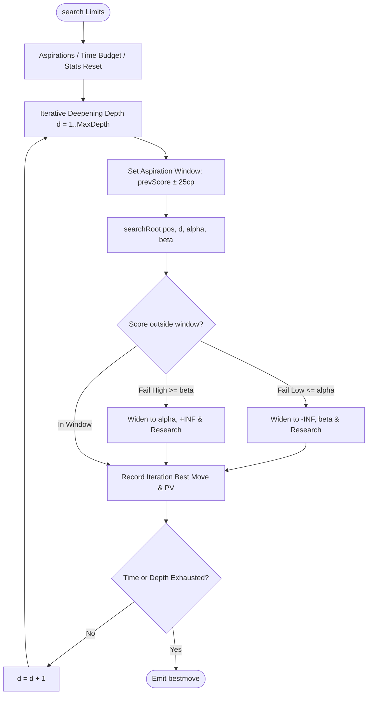

# System Architecture and Execution Flow

This document details the control flow, execution lifecycle, operational pipelines, and data transformations within ChessBot / PocketChess.

---

## 1. Top-Level Architectural Overview

```
                      +-----------------------------+
                      |         UCI Front-End       |
                      |      (engine/uci.cpp)       |
                      +--------------+--------------+
                                     |
              +----------------------+----------------------+
              |                                             |
   [Position Commands]                                [Go Commands]
              |                                             |
   +----------v-----------+                      +----------v----------+
   |   Position & State   |                      |     Alpha-Beta      |
   | (engine/position.*)  |                      |     Search Loop     |
   +----------+-----------+                      | (engine/search.*)   |
              |                                  +----------+----------+
              |                                             |
+-------------v--------------+                   +----------v----------+
|  Move Generation & PEXT    |                   |  Transposition      |
|    (engine/movegen.*)      |                   |  Table (Aging)      |
+----------------------------+                   |  (engine/tt.*)      |
              |                                  +----------+----------+
              |                                             |
+-------------v---------------------------------------------v----------+
|                         Evaluation Pipeline                          |
|  - Classical PeSTO Tapered Eval (engine/evaluate.cpp)                |
|  - Embedded HalfKP AVX2 NNUE (nnue/evaluation_bridge.cpp)            |
+----------------------------------------------------------------------+
```

---

## 2. UCI Command Execution Flow

When launched as a standalone binary or connected to an external chess GUI (CuteChess, Arena, Banksia, Lichess bot):

1. **Initialization (`main.cpp` / `UciEngine::UciEngine`):**
   - Instantiates `UciEngine`.
   - Allocates the persistent `TranspositionTable` with the default 16 MB capacity.
   - Initialises bitboard tables and slider PEXT lookup tables.
2. **Protocol Handshake (`uci` / `isready`):**
   - Responds with `id name PocketChess`, `id author PrathamKapoor`.
   - Advertises supported options (`Hash`, `Threads`, `UseNnue`, `NnuePath`).
   - Emits `uciok` and `readyok`.
3. **Game Setup (`ucinewgame` / `position`):**
   - `ucinewgame`: Resets position state stack and clears the persistent `TranspositionTable` (`tt_.clear()`).
   - `position startpos [moves ...]`: Initializes root position to standard FEN and applies move strings sequentially via legal move validation.
   - `position fen <FEN> [moves ...]`: Parses custom FEN, verifies king counts, castling rights, and en passant squares, and applies moves.
4. **Search Dispatch (`go`):**
   - Parses limits: `depth`, `movetime`, `nodes`, `wtime`, `btime`, `winc`, `binc`, `movestogo`, `infinite`.
   - Computes time budget via `computeTimeBudget`:
     $$\text{movesLeft} = \text{movestogo} + 40$$
     $$\text{soft} = \frac{\text{time}}{\text{movesLeft}} + \frac{3 \cdot \text{inc}}{4}$$
     $$\text{limit} = \min\left(\text{time} \cdot \frac{2}{5},\, \text{soft} \cdot 3\right) - \text{overhead}$$
   - Runs `runSearch()` either synchronously or on a background worker thread (`go infinite`).
   - Emits iterative UCI `info` lines and the final `bestmove`.

---

## 3. Search Engine Flow

The engine implements iterative deepening Negamax search with alpha-beta pruning, quiescence search, and aspiration windows.



### 3.1 `searchRoot` Steps:
1. Probe root Transposition Table for previous best move.
2. Generate all legal moves (`generateLegal`).
3. Score and sort moves using `scoreMoves` (TT move -> Good Captures -> Promotions -> Killers -> History -> Bad Captures).
4. Iterate through candidate moves:
   - Make move (`pos.doMove(m)`).
   - If move index `i == 0`, execute full-window Negamax search.
   - If `i > 0`, execute null-window PVS search (`[alpha, alpha + 1]`). If it refutes alpha, re-search with full window.
   - Unmake move (`pos.undoMove(m)`).
   - Update alpha, track PV line in triangular table (`pvTable_`).
   - Check time / stop interrupt periodically (every 1024 nodes).
5. Store root evaluation and best move into `TranspositionTable`.

### 3.2 Recursive `negamax` Steps:
1. Increment node counter; check search limits / timeouts.
2. Check for draw rules: 50-move counter (`isFiftyMoveDraw`), 3-fold repetition (`isDrawByRule`), insufficient material.
3. Check for mate distance pruning (`alpha < matedInScore(ply)`).
4. **Transposition Table Probe:**
   - Lookup 64-bit Zobrist key.
   - If hit and entry depth >= required depth:
     - Exact bound: return score.
     - Lower bound >= beta: cutoff (fail high).
     - Upper bound <= alpha: cutoff (fail low).
5. **Check Extensions:** If in check, extend search depth by +1.
6. **Pruning Guards (Non-check, Non-PV):**
   - **Razoring:** If depth == 1 and static evaluation + 300 cp <= alpha, jump directly to quiescence search.
   - **Reverse Futility Pruning (RFP):** If depth <= 2 and static eval - margin >= beta, cutoff early.
   - **Null Move Pruning (NMP):** If depth >= 4 and side has non-pawn pieces, make null move with reduction R=2. If score >= beta, fail high.
7. **Move Loop & PVS:**
   - Score and sort moves.
   - For each legal move, recurse with Negamax.
   - Maintain beta cutoffs, updating killers and history table on quiet refutations.
8. Store result to Transposition Table with exact, upper, or lower bound tag.

### 3.3 Quiescence Search (`qsearch`):
1. Evaluate stand-pat score. If stand-pat >= beta, cutoff.
2. If stand-pat > alpha, alpha = stand-pat.
3. Generate only tactical moves (captures and promotions via `generateLegalCaptures`).
4. Order captures using MVV-LVA and Static Exchange Evaluation (`seeCapture`).
5. Prune losing captures (SEE < 0).
6. Search captures recursively until tactical stability is reached.

---

## 4. Evaluation Dispatch Flow

```
                      Position to Evaluate
                                |
               +----------------+----------------+
               |                                 |
       g_useNnue == true                 g_useNnue == false
               |                                 |
     +---------v----------+            +---------v----------+
     |   NNUE Inference   |            |   Classical PeSTO  |
     |  Accumulator Load  |            |   Material Sum     |
     |  AVX2 Clipped ReLU |            |   Piece-Square PSQT|
     |  Output Dot Product|            |   Pawn Structure   |
     +---------+----------+            |   King Safety      |
               |                       +---------+----------+
               |                                 |
               +----------------+----------------+
                                |
                         Negamax Score
```

1. **Classical Evaluation:**
   - Computes Game Phase (0 for Endgame to 24 for Opening).
   - Evaluates piece values and interpolated PeSTO piece-square values for both colors.
   - Computes positional features: bishop pair bonus, rook on open/semi-open files, passed pawns, isolated pawns, and king safety zones.
   - Linearly blends Opening and Endgame values by game phase factor.
2. **NNUE Evaluation:**
   - Identifies active piece features (`HalfKP` index: `piece_index + square + king_square * 640`).
   - Computes or retrieves accumulated hidden layer vectors.
   - Applies clipped ReLU activation $[0, 127]$.
   - Computes output layer dot product using AVX2 SIMD intrinsics.
   - Rescales output to centipawns and clamps within mate sentinel thresholds.

---

## 5. Offline Match & Self-Play Verification Flow

To guarantee that code modifications yield true playing strength rather than regression:

1. **Tournament Runner (`match/matchrunner.py`):**
   - Coordinates match play between two UCI engines over standard time controls (e.g. 5s+0.05s).
   - Alternates colors and opening books to eliminate first-move or book bias.
   - Detects adjudication rules: 3-fold repetition, 50-move rule, checkmate, stalemate, illegal move forfeits, and clock timeouts.
   - Records clean PGN files and emits JSON match results.
2. **SPRT Statistical Testing (`match/sprt.py`):**
   - Applies Wald Sequential Probability Ratio Test on win/draw/loss outcomes.
   - Hypotheses: $H_0: \text{Elo} \le 0$ vs $H_1: \text{Elo} \ge 10$ with $\alpha=0.05, \beta=0.05$.
   - Terminates automatically when statistical certainty is achieved.
